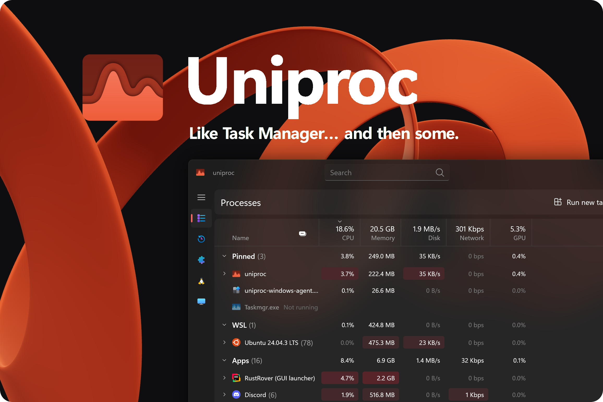

<div align="center">
  

**A system monitor for Windows 11 and WSL.**

[](https://www.rust-lang.org/)
[](https://learn.microsoft.com/windows/apps/winui/winui3/)
[]()
</div>

---

## What is it?

**Uniproc** is a system monitor for Windows 11 built with **Rust** and **WinUI 3**. It shows processes, services and
machine metrics from Windows, WSL and Docker in one place, instead of one tool per environment.

## Motivation

* **WSL transparency.** Stop treating WSL as a `vmmem` black box. Uniproc shows the resource consumption of every
  individual Linux process — [asked for in 2021](https://github.com/microsoft/WSL/issues/6881) and still not resolved
  officially.
* **Appearance.** Tools like Process Hacker are capable but look their age. Uniproc follows Fluent Design, so a
  monitoring tool does not have to feel like it was built in 2003.

## Build and run

The current development version is built from source. The UI runs on Windows 11;
Linux monitoring runs inside WSL 2. A WSL distribution is optional for Windows monitoring.

### Windows prerequisites

- Git and Rust installed through rustup. This repository pins stable Rust 1.99.1
  in `rust-toolchain.toml`, including its `rustfmt` component. Rustup installs
  the pinned toolchain when you run Cargo from the repository directory.
- Visual Studio Build Tools with the Desktop development with C++ workload and a Windows SDK.
- The Cap'n Proto compiler on `PATH`, required by `uniproc-protocol` during compilation.
  CI uses version 1.3.0. If Chocolatey is installed, run
  `choco install capnproto --version=1.3.0 --no-progress -y` from an elevated terminal.
  Check availability with `capnp --version` in the terminal used for Cargo.

`sccache` is optional. To use it, install it separately and set
`$env:RUSTC_WRAPPER = "sccache"` in your PowerShell session.

Clone the application and its Windows service into sibling directories:

```powershell
git clone https://github.com/uniproc-dev/uniproc.git
git clone https://github.com/uniproc-dev/uniproc-windows-agent.git
git -C uniproc-windows-agent checkout v0.23.0
```

The service checkout must match the `uniproc-windows-agent` dependency's tag or
revision in the application's `Cargo.toml`. The commands above use its current tag.
The service repository selects its own Rust toolchain through rustup.

### Start the Windows service

Build it from its repository:

```powershell
cd uniproc-windows-agent
cargo build --locked --release -p uniproc-windows-service
```

For a persistent installation, open an elevated PowerShell in that directory and run:

```powershell
$serviceDirectory = Join-Path $env:ProgramFiles 'Uniproc'
New-Item -ItemType Directory -Force -Path $serviceDirectory | Out-Null
Copy-Item -LiteralPath '.\target\release\uniproc-windows-agent.exe' -Destination $serviceDirectory
$serviceExecutable = Join-Path $serviceDirectory 'uniproc-windows-agent.exe'
& $serviceExecutable install
Start-Service -Name UniprocProcessMonitor
```

These commands are for a fresh installation. `install` registers an automatically
started LocalSystem service but does not start it immediately. It records the
executable's current path, so place the executable at its permanent location first.

For a temporary development session, run the built executable with `run` in an
elevated terminal instead:

```powershell
.\target\release\uniproc-windows-agent.exe run
```

Keep that terminal open; Ctrl+C stops the foreground service. Do not run it alongside
the installed service: both use the same monitoring resources and IPC endpoint.
Running the executable without a subcommand is reserved for the Windows Service
Control Manager, not for starting it from a terminal.

To remove a persistent installation, run `& $serviceExecutable uninstall` from an
elevated terminal. It stops and unregisters the service; it does not delete the executable.

### Start the application

From the application repository, in a regular PowerShell:

```powershell
cd ..\uniproc
cargo run --locked
```

The UI connects to the running Windows service. To build an optimized UI without
starting it, use `cargo build --locked --release -p desktop`.

In debug builds, set `$env:UNIPROC_NO_DEVTOOLS = '1'` before starting if you do not
want the separate devtools window. Debug logs are written to `run_desktop.log` in
the working directory; long-running debug sessions can produce large logs.

If you use devtools, build it from a `guinea-plugins` checkout at `v0.31.0`:
run `cargo install --locked --path tools/devtools` in that checkout. The application
launches `GUINEA_DEVTOOLS_BIN`, or `guinea-devtools` from `PATH`; update an older
installed binary alongside the application.

### Add WSL monitoring

Use a WSL 2 distribution with kernel 6.3 or newer and BTF available at
`/sys/kernel/btf/vmlinux`. In an Ubuntu distribution, install the build prerequisites:

```sh
sudo apt-get update
sudo apt-get install -y build-essential pkg-config git clang llvm libbpf-dev libelf-dev zlib1g-dev capnproto
```

Install Rust through rustup inside the distribution, then build and install the Linux service:

```sh
git clone https://github.com/uniproc-dev/uniproc-linux-agent.git
cd uniproc-linux-agent
git checkout v1.2.0
cargo build --locked --release -p uniproc-linux-agent
sudo install -m755 target/release/uniproc-linux-agent /usr/local/bin/uniproc-agent
```

The Linux repository selects Rust 1.98.1. Its CO-RE header is committed; ordinary
builds do not require regenerating `vmlinux.h`.

Uniproc currently uses the default WSL distribution and
`/usr/local/bin/uniproc-agent`. Select the prepared distribution from Windows with
`wsl --set-default <distribution-name>` before starting the UI. Uniproc launches
the Linux service as root through `wsl.exe` and supplies a temporary connection key
on stdin; do not start a second copy manually. Systemd is needed for Linux service
information, and Docker's socket for container metadata.

### Checks

From the application repository:

```powershell
cargo build --locked --workspace --all-targets
cargo test --locked --workspace
cargo check --locked -p desktop --features dhat-heap
```

The tests use fakes and do not require installed monitoring services. With the real
Windows service running, `cargo run --locked -p xtask -- agent-check` checks its
integration. Add `--wsl` to include the prepared WSL service. These live checks are
separate from the fake-based tests and use the actual monitoring environment.
