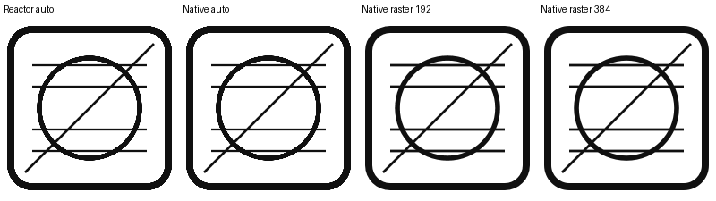
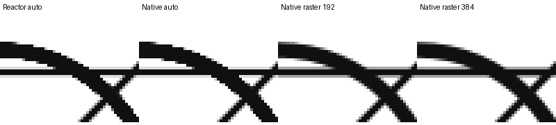

# Allow explicit SVG raster dimensions to avoid harsh edges from native automatic sizing

## Problem

An SVG rendered through `Image::source_svg` has visibly harsh staircase edges even with an independent source and an explicit 192×192 Image size. Direct WinUI reproduces exactly the same pixels with automatic SvgImageSource raster dimensions. Setting native raster dimensions before loading the same SVG improves the edges without changing its geometry or display size.

This is a request to make the native capability available through the image API, not a claim that Reactor disables antialiasing. There are partially covered edge pixels in the automatic case. The exact native decode dimensions and resampling filter have not been established.

## Reproduction

Attach `svg-antialias-repro.zip`, extract it, then run on Windows:

```powershell
$env:WINUI_WINMD = '<windows-rs>/crates/tools/reactor/winmd'
cargo run --locked
```

Use WinUI metadata from snapshot `2c6ce7a1edaefb6e585aa3fb112617d1d8211392`, matching the published `windows-reactor-pre 0.106.0` package. The reproduction uses that published preview, not a separately built upstream checkout. Older source trees place metadata in `crates/tools/reactor-metadata/winmd`.

The window stays open and displays four independent images, all 192×192 DIP:

1. Reactor `source_svg`, automatic raster dimensions.
2. Direct native SvgImageSource, automatic raster dimensions.
3. Direct native SvgImageSource, raster dimensions 192×192 set before SetSourceAsync.
4. Direct native SvgImageSource, raster dimensions 384×384 set before SetSourceAsync.

Compare the circle boundary and diagonal. The first two have harsh edges; the last two are smoother. Native sources are assigned through ElementRef to bypass Reactor's source creation and byte cache. All native loads must report success. The program uses the same original SVG bytes for every image, has no Guinea dependency, and contains no capture instrumentation.

The native operation producing the improvement is:

```rust
source.SetRasterizePixelWidth(192.0)?;
source.SetRasterizePixelHeight(192.0)?;
source.SetSourceAsync(&stream)?;
```

The Image remains 192×192. The 384×384 case is an additional supersampling control; it is not required to demonstrate improvement over automatic sizing.

## Evidence





An independent measurement program exported the four Image controls through RenderTargetBitmap at rasterization scale 1. Reactor automatic and native automatic output were pixel-identical after compositing onto white. Explicit 192×192 raster dimensions visibly improved the boundaries. These captures are included in the archive; the visual reproduction does not capture or resize its output.

## Requested capability

Please consider exposing explicit raster dimensions for SVG sources, corresponding to native RasterizePixelWidth/Height, applied before loading. This report deliberately leaves the API shape open. Size units and behavior with DPI changes should be explicit; Image layout width/height alone did not provide the same result in this reproduction.

The separate shared-source/different-sizes report is related: source identity and native reuse must allow differently sized consumers to retain image quality. A common internal cause has not been proven, and any implementation should be checked against both reproductions.

Measured environment: Windows 11 build 26300 x64, Microsoft.ui.xaml.dll 3.2.3.2608, rasterization scale 1, NVIDIA nvwgf2umx.dll 32.0.15.8157, Rust 1.99.1. Results come from the published preview package; direct upstream behavior has not been independently tested.
