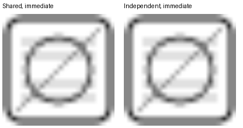

# SVG images appear blurry when mounted initially

In windows-reactor, SVG images displayed in the initial component view appear blurry at larger sizes. This affects both clones of a shared EncodedImage and independent allocations containing identical SVG bytes.

The reproduction immediately displays two rows of images at 24, 48, 96 and 192. The top row shares one EncodedImage; the bottom row uses independent allocations. Both 192×192 images are blurry.

An earlier control mounted the comparison after a five-second delay. In that control, the independent 192×192 image retained substantially more detail, while the shared source remained blurry. Source sharing alone therefore does not explain the behavior; initial mounting also changes the result. The internal decode dimensions and cause have not been established.

What determines SVG raster resolution here, and how should SVG sources be used to retain detail at the Image's display size?

The attached svg-shared-size-repro.zip contains the full immediate-display reproduction. Extract and run `cargo run --locked`.

The earlier delayed control, for comparison:

