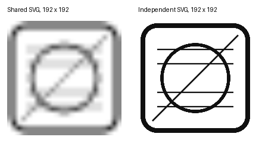

# A shared SVG source becomes blurry when used by Image controls of different sizes

## Reproduction

The attached standalone `svg_sizes` binary uses published `windows-reactor-pre 0.106.0`, a preview repackaging of microsoft/windows-rs snapshot `2c6ce7a` according to package metadata. A direct upstream checkout was not separately built.

Source revision: `2c6ce7a1edaefb6e585aa3fb112617d1d8211392`.

The component creates one `EncodedImage` for an original SVG drawing, then passes clones to four `Image` controls sized 24, 48, 96 and 192 DIP. A comparison row uses the same SVG bytes in four independent allocations. All controls have explicit width and height. No application framework or icon library is involved.

```rust
Image::new()
    .source_svg(shared.clone())
    .width(size)
    .height(size)
```

Run `cargo run --locked --bin svg_sizes`. After five seconds, compare the shared and independent images at 192 DIP. The top row is blurry; the bottom row is sharp. A fresh-process control prewarming the shared source at 192 DIP also reproduced the problem once multiple sizes were displayed together.

## Evidence



The images were exported through native RenderTargetBitmap from the two actual Image controls, not reconstructed or resized for the comparison. Both reported actual dimensions 192×192 and rasterization scale 1. The native SvgImageSource RasterizePixelWidth/Height getters returned infinity; these values do not establish the internal bitmap dimensions.

The shared render had 29,984 pixels with partial alpha and no fully opaque pixels. The independent render had 1,410 partially covered and 8,400 fully opaque pixels. This supports the visible loss of detail without relying on a scaled screenshot.

## Expected behavior

Sharing encoded SVG data across controls should preserve vector image quality at each display size. Please investigate whether native SVG source caching needs rasterization-size awareness or another mechanism for differently sized consumers. The exact native rasterization/cache mechanism has not been established.

Creating independent source byte allocations avoids this visual problem in the control, but it is not proposed as an application workaround: a separate reproduction in `../svg-memory` demonstrates substantial native memory cost per distinct source.

Environment: Windows 11 build 26300 x64; Microsoft.ui.xaml.dll file version 3.2.3.2608; scale 1; NVIDIA nvwgf2umx.dll 32.0.15.8157; Rust 1.99.1.
